# ParkFlow mobile application flowchart

Inspected: 2026-10-08. Scope: the mobile repository only. This document traces Expo Router routes, screen actions, stores, and mobile API-service calls. It describes the existing implementation, not a proposed redesign or a guarantee about server-side behavior. No backend or web-admin files were scanned.

## Reading the charts

The first chart is the whole-app navigation overview. Detailed charts below expand registration, reservations, QR scanning, manual entry/exit, account management, and asynchronous events. Identically named destinations across charts refer to the same screen/workflow. Solid arrows are screen actions or immediate branches; dotted arrows are external events or separately expanded workflows. Diamonds indicate decisions. Error branches remain in their current workflow unless a navigation action is explicitly implemented.

The diagram skill's flowchart guidance was used for decision shapes, logical grouping, and readable detail views. These are Mermaid source diagrams in Markdown; no external Figma file is created.

## 1. Whole-app overview

```mermaid
flowchart TD
    start(["Open mobile app"]) --> restore["Restore token and user"]
    restore --> loginChoice{"Signed-in user available?"}
    loginChoice -->|"No"| welcome["Walkthrough on first launch"]
    welcome --> login["Login"]
    login -->|"Email and password"| authenticate["Sign-in request"]
    login -->|"Microsoft"| microsoft["Browser sign-in and code exchange"]
    microsoft --> authenticate
    authenticate -->|"Success"| resolve["Resolve role and onboarding"]
    authenticate -->|"Failure"| loginError["Show sign-in error"]
    loginError --> login
    login -->|"Create account"| registration["Registration wizard"]
    login -->|"Forgot password"| recovery["Email, code, new password"]
    recovery --> login
    registration --> resolve
    loginChoice -->|"Yes"| resolve
    resolve -->|"Incomplete"| registration
    resolve -->|"Student or personnel"| clientHome["Client Home"]
    resolve -->|"Guard"| guardHome["Guard Home"]
    resolve -->|"Unsupported or unassigned"| login

    subgraph clientArea ["Student, faculty, and university staff"]
        clientHome --> vehicleQr["Vehicle picker and QR pass"]
        clientHome --> activeBanner["Active session and timer"]
        clientHome --> reservations["Parking reservations"]
        clientHome --> clientCharges["Unpaid charges and receipts"]
        clientHome --> clientHistory["Parking and payment history"]
        clientHome --> clientSchedule{"Client type?"}
        clientSchedule -->|"Student"| weekly["Weekly schedule"]
        clientSchedule -->|"Personnel"| personnelHours["Read-only parking hours"]
        weekly --> verifyDocs["Schedule and COR setup"]
        personnelHours --> employeeId["Employee ID verification"]
        clientHome --> clientAccount["Client Account"]
        clientAccount --> vehicles["Manage vehicles"]
        clientAccount --> verifyDocs
        clientAccount --> employeeId
        clientAccount --> reservations
    end

    subgraph guardArea ["Guard operations"]
        guardHome --> scanner["QR scanner"]
        guardHome --> manualEntry["Manual plate entry"]
        guardHome --> manualExit["Manual plate exit"]
        guardHome --> todayPreview["Today's reservations preview"]
        todayPreview --> todayAll["Search and paginate today's reservations"]
        guardHome --> sessions["Active Sessions"]
        sessions --> sessionDetail["Session detail sheet"]
        guardHome --> guardHistory["Parking and payment history"]
        guardHome --> guardCharges["Charges and Citations"]
        guardHome --> guardAccount["Guard Account"]
        scanner --> scanOutcome["Entry, exit, notice, or error"]
        manualEntry --> manualPass["Entry pass or inline exit result"]
        manualExit --> exitReceipt["Exit result and charges"]
    end

    subgraph sharedArea ["Shared account and support"]
        clientAccount --> profile["Profile and documents"]
        guardAccount --> profile
        clientAccount --> accountCenter["Account Center"]
        guardAccount --> accountCenter
        accountCenter --> emails["Linked emails"]
        emails --> emailDetail["Email details"]
        accountCenter --> password["Set or reset password"]
        emailDetail --> password
        clientAccount --> theme["Light, dark, or system theme"]
        guardAccount --> theme
        clientAccount --> support["Support and information"]
        guardAccount --> support
        support --> help["Help Center"]
        support --> feedback["Feedback and Suggestion"]
        support --> contact["Contact us"]
        support --> about["About, Updates and Terms"]
        clientHome --> notifications["Notification log and details"]
        guardHome --> notifications
        notifications --> notificationAction["Open referenced feature"]
        clientAccount --> logoutConfirm{"Confirm log out?"}
        guardAccount --> logoutConfirm
        logoutConfirm -->|"Yes"| clearSession["Clear token, caches and stores"]
        logoutConfirm -->|"Cancel"| remain(["Stay in current account"])
    end
    clearSession --> login
```

On repeat signed-out launches, the walkthrough is skipped. The overview compresses startup routing; the exact priority and role-specific differences are below. Visitors do not have an app login or dashboard: guards record their visits through Manual Entry.

## 2. Startup, sign-in, recovery, and routing

Sources: [root layout](../app/_layout.tsx), [index](../app/index.tsx), [auth store](../features/auth/store/auth.store.ts), [LoginPage](../features/auth/pages/LoginPage.tsx), [ForgotPasswordPage](../features/auth/pages/ForgotPasswordPage.tsx).

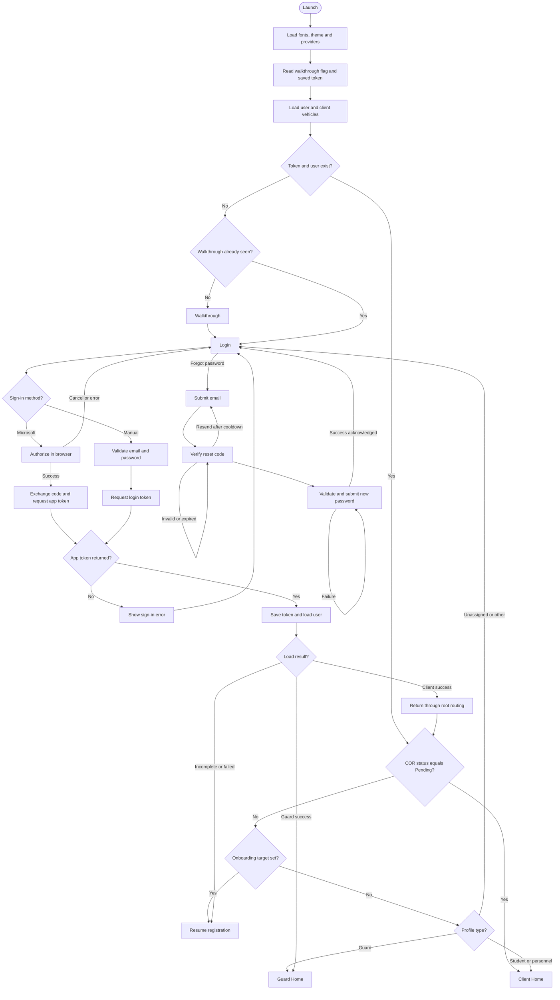

User loading normally checks profile fields, role details, vehicle, student schedule, and documents in order. Personnel skip the personal-schedule check. A completed onboarding marker bypasses some missing vehicle/schedule/document checks. The guard-token path returns success before those client checks.

Root routing now checks the missing onboarding step before Pending COR. Failed account, vehicle, or schedule requests do not restart registration: startup/registration offer retry, and login shows an account-check error. Only an actual missing profile returns to the profile step; expired authentication requires sign-in. The schedule probe uses the existing ScheduleService. Route layouts do not themselves constitute backend authorization.

## 3. Registration and role-dependent verification

Sources: [RegisterPage](../features/auth/pages/RegisterPage.tsx), [email verification](../features/auth/components/EmailVerificationView.tsx), [ScheduleSetupPage](../features/account/pages/ScheduleSetupPage.tsx).

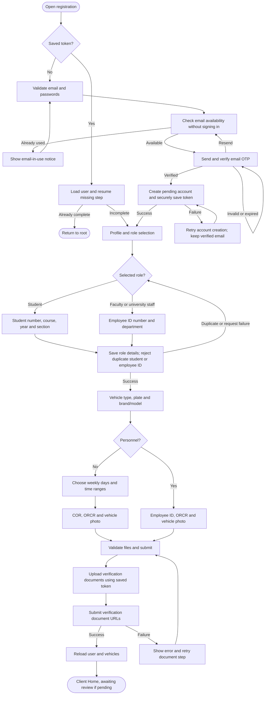

The wizard resumes at the actual missing step, which can be role, vehicle, schedule, or documents rather than profile. New users create a pending account after email verification and save each completed step. Passwords are cleared from memory once the token is saved; they are not persisted as a draft. Form/file errors stay on the affected step. Vehicle choices are Motorcycle and Car; historical enum values remain stable. Personnel never fill a weekly schedule in this wizard.

After onboarding, clients use Schedule/COR setup or Employee ID verification to resubmit documents. Student schedules are editable; personnel hours are read-only and supplied by system settings. Setup changes are blocked while the client has an active parking session. Document submission returns to a review state; approval happens externally, not in the mobile app.

## 4. Client Home, QR visibility, schedules, and charges

Sources: [UserHomePage](../features/user/pages/UserHomePage.tsx), [QRCodeDisplay](../features/user/components/QRCodeDisplay.tsx), [UserSchedulePage](../features/schedule/pages/UserSchedulePage.tsx), [verification guard](../hooks/useVerificationGuard.ts).

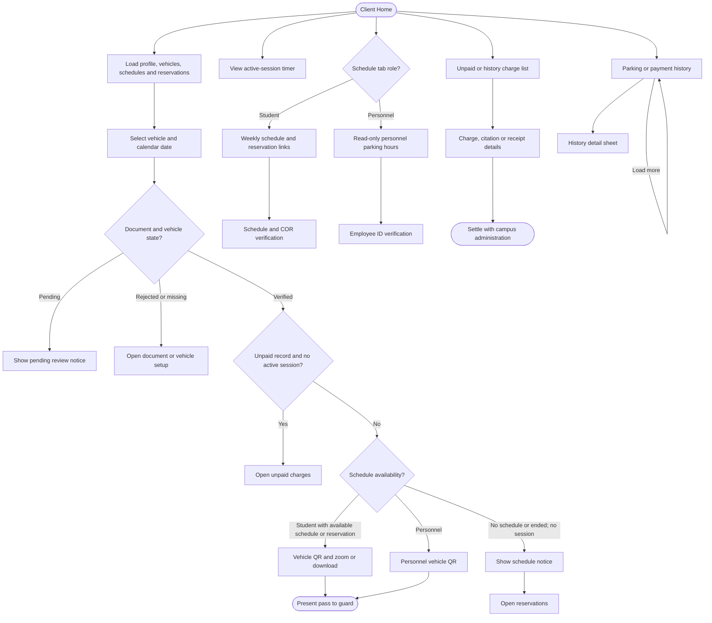

This chart summarizes UI gating, not a new gate-eligibility algorithm. QRCodeDisplay keeps exit-related access distinct from fresh entry: several restriction notices apply only when there is **no active session**. Any unpaid record triggers its suspended-access state, not a three-violation threshold. Personnel are not locally disabled merely because the free window has ended; the mobile UI displays policy rather than calculating the final server charge.

The app does not expose a confirmed, wired self-service payment action in the inspected charge screens. Payment history/receipts are display flows; settlement is not represented as a completed in-app transaction.

## 5. Reservation creation, capacity, passes, and cancellation

Sources: [SchedulePage](../features/account/pages/SchedulePage.tsx), [reservation store](../features/schedule/store/reservation.store.ts), [reservation service](../features/schedule/services/reservation.service.ts).

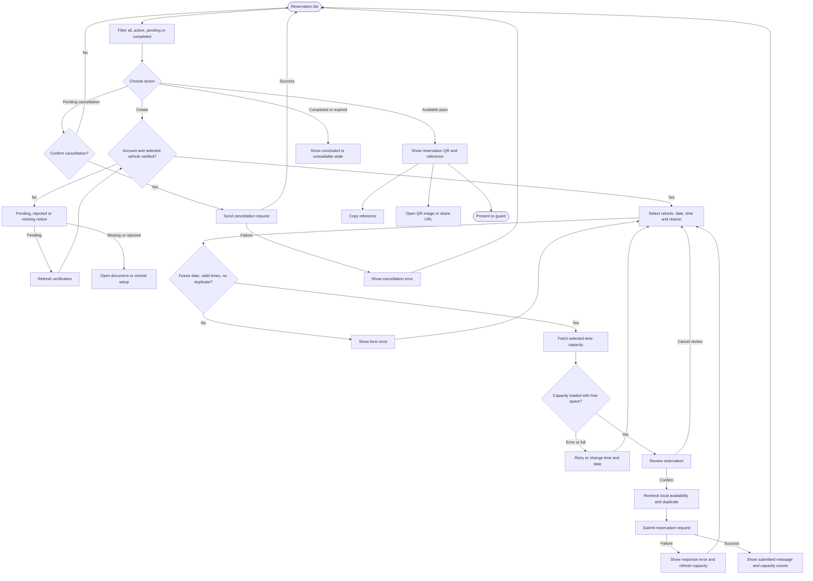

The mobile create form does not provide a Special reservation-type selector. Pass rendering can display a Special pass supplied by the API. It requires a future date and prevents duplicates for the same date locally. The availability endpoint supplies counts for the selected interval; the mobile app does not itself enforce database capacity.

**Do not infer approval from the success copy:** SchedulePage says a submitted request is pending approval, but the actual status comes from the response/server. This mobile-only inspection cannot establish whether the backend auto-approves. Similarly, repeated entry during one reservation is not guaranteed by the UI; it depends on the entry API and reservation state.

## 6. Guard dashboard, sessions, reservations, and history

Sources: [GuardHomePage](../features/guard/pages/GuardHomePage.tsx), [GuardReservationsPage](../features/guard/pages/GuardReservationsPage.tsx), [today reservations hook](../features/guard/hooks/useTodayReservations.ts), [SessionPage](../features/session/pages/SessionPage.tsx), [GuardViolationsPage](../features/guard/pages/GuardViolationsPage.tsx), [HistoryPage](../features/history/pages/HistoryPage.tsx).

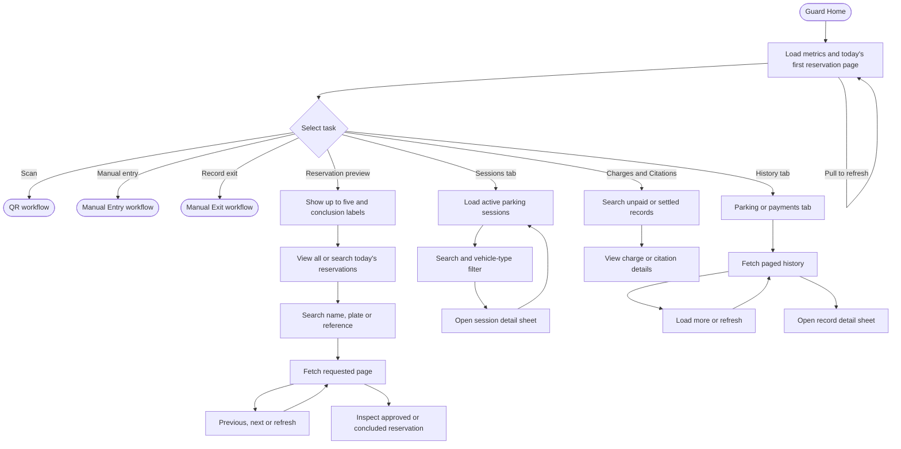

Guard reservations are paged in five-row pages; search resets to page one after a debounce. The capacity notice and conclusion labels are display data from the API. The list does **not** let the guard manually mark a reservation concluded. Refreshes also occur on focus, reservation/parking events, and a focused 30-second query interval. Guard history uses the shared history screen; API authorization determines the data scope.

## 7. Guard QR scanning: student IDs, reservation passes, and vehicle QR

Sources: [ScanQrPage](../features/qr/pages/ScanQrPage.tsx), [StudentScanResultCard](../features/qr/components/StudentScanResultCard.tsx), [QR store](../features/qr/store/qr.store.ts), [ScanConflictPage](../features/qr/pages/ScanConflictPage.tsx).

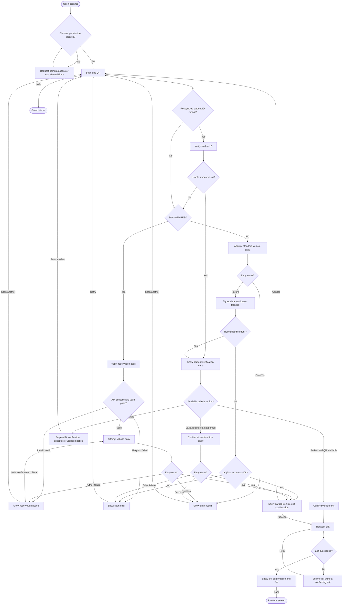

For a valid RES- pass, the scanner attempts entry immediately after verification; it is not exclusively a review-then-confirm flow. Its reservation result can also offer a check-in retry. The student ID card only exposes vehicle entry when valid, not parked, and a registered vehicle QR is available; exit is offered when currently parked and that QR is available. ID verification alone is not a recorded vehicle entry.

Entry success and scan errors are rendered inline in ScanQrPage using result/error components. The parked conflict and exit confirmation navigate to separate routes. The scanner's back handler explicitly dismisses to Guard Home. ScanReceiptPage exists but has no wired incoming payment navigation found in the inspected sources; it is documented in the route inventory rather than connected to a fictional payment action.

## 8. Manual Entry: registered users and visitors

Source: [manual-input](../app/(guard)/manual-input.tsx), [visitor service](../features/session/services/visitor.service.ts), [manual-pass](../app/(guard)/manual-pass.tsx).

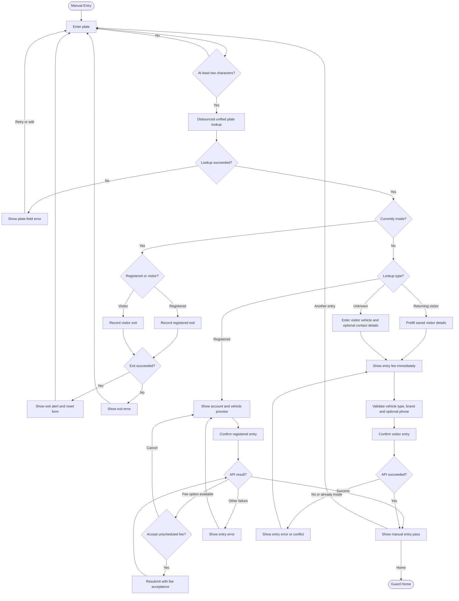

Returning visitors can reuse their saved name, contact, brand, and vehicle type. A blank name falls back to Visitor; brand/model and vehicle type are required; phone is validated if supplied. Unknown plates become a visitor-entry request only after a successful lookup identifies them as unknown. A lookup network failure is **not** interpreted as an unknown visitor.

Registered entry is server-driven: successful free/fee entries show returned pass data; a fee option is offered only when the response says `feeOptionAvailable`. The visitor fee is the returned quote or a 20-peso UI fallback, displayed before entry. The visitor pass explicitly says payment has not been recorded. Entry/exit failures leave the guard in the workflow; the inline exit paths reset only after success. Submission locks prevent repeated entry requests.

## 9. Dedicated Manual Exit

Source: [manual-exit](../app/(guard)/manual-exit.tsx).

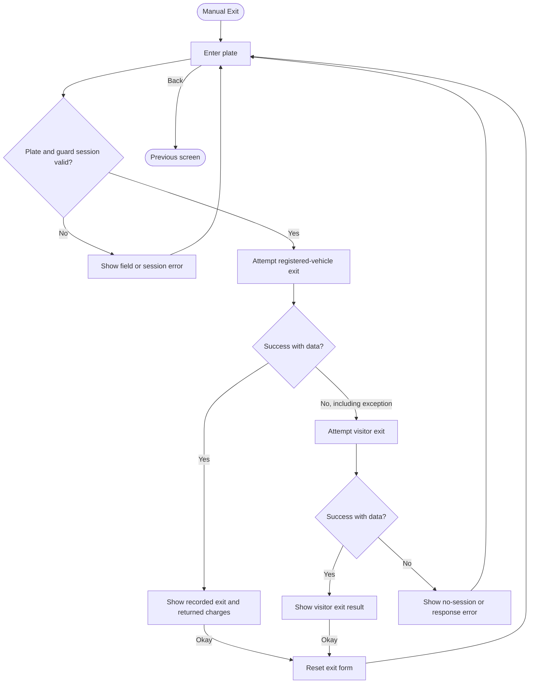

The fallback is broad: **any** registered-exit failure, including an exception, triggers a visitor-exit attempt. The visitor response is converted to a display result with zero penalty/overstay values in this screen; that is not proof that visitor payment was settled. Returned registered charges are shown, but there is no payment-confirmation step here.

## 10. Account, vehicle management, support, and notifications

Sources: [AccountMenu](../features/account/components/AccountMenu.tsx), [VehiclePage](../features/account/pages/VehiclePage.tsx), [AccountCenterPage](../features/account/pages/AccountCenterPage.tsx), [EmailsPage](../features/account/pages/EmailsPage.tsx), [SetPasswordPage](../features/account/pages/SetPasswordPage.tsx), [FeedbackPage](../features/account/pages/FeedbackPage.tsx).

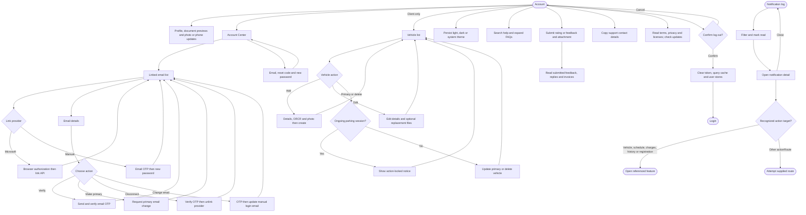

Guard Account omits Personal & Vehicles options; shared account/support tools remain available. Vehicle creation/editing includes document uploads and server validation; unsuccessful mutations display errors and preserve the form. Add/edit entry actions, primary changes, and deletion have ongoing-session locks in VehiclePage; the chart expands the primary/delete decision, while add/edit controls can show the same locked notice before opening their form.

NotificationPage aliases NotificationsLogPage. Notification-detail looks up a supplied ID in the notification store, rather than fetching an arbitrary missing record. Notification preferences have a standalone feature component with local React toggle state, but no matching route is exported in the current app tree; no persisted preferences or email/SMS delivery are inferred. The separate SetPasswordModal component simulates a delay and is not the routed SetPasswordPage workflow.

## 11. Realtime events, connection errors, and updates

Sources: [root layout](../app/_layout.tsx), [account watcher](../components/shared/RealtimeAccountStatusWatcher.tsx), [NetworkErrorScreen](../components/shared/NetworkErrorScreen.tsx), [notification store](../features/notification/store/notification.store.ts).

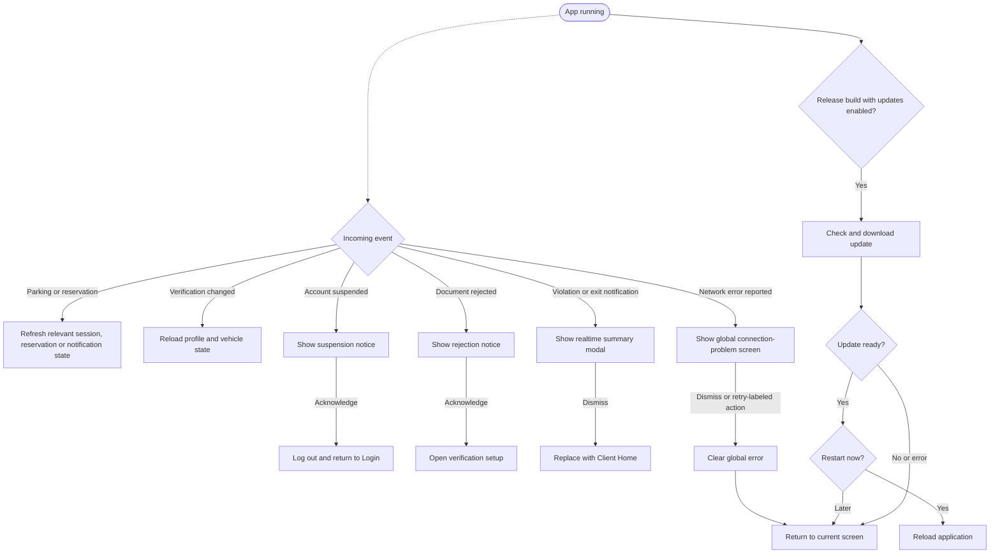

The global connection screen clears the error when its actions are pressed; it does not itself replay the failed request. Relevant screens must retry/refetch their own request. Manual plate lookup, reservation availability, and guard reservation fetching can handle errors locally instead of invoking this global screen.

The realtime summary dismiss handler in the root layout routes to Client Home, not a role-dependent destination. This is recorded as current behavior, not corrected in this documentation task. Approval and settlement notifications are external events, not mobile administrative actions. Update checks are skipped in development/unsupported environments; About also offers a manual update check.

## 12. Route coverage and limitations

Every non-layout route found under app is listed below. Existence of a file does not prove that an ordinary UI action reaches it. Unwired or legacy routes remain documented rather than silently discarded.

| Route file | Implemented purpose / reachability |
|---|---|
| [app/index.tsx](<../app/index.tsx>) | Startup and role/onboarding routing |
| [app/redirect.tsx](<../app/redirect.tsx>) | Microsoft callback waiting screen; Login fallback after 1.5 seconds |
| [app/(auth)/forgot-password.tsx](<../app/(auth)/forgot-password.tsx>) | Email request, reset-code verification, new password |
| [app/(auth)/login.tsx](<../app/(auth)/login.tsx>) | Manual or Microsoft sign-in |
| [app/(auth)/onboarding-profile.tsx](<../app/(auth)/onboarding-profile.tsx>) | Separate legacy onboarding screen; current wizard uses RegisterPage |
| [app/(auth)/onboarding-role.tsx](<../app/(auth)/onboarding-role.tsx>) | Redirects to RegisterPage; not the legacy role page |
| [app/(auth)/onboarding-schedule.tsx](<../app/(auth)/onboarding-schedule.tsx>) | Separate legacy schedule/document screen |
| [app/(auth)/onboarding-vehicle.tsx](<../app/(auth)/onboarding-vehicle.tsx>) | Separate legacy onboarding screen |
| [app/(auth)/pending.tsx](<../app/(auth)/pending.tsx>) | Existing pending screen; no main-flow navigation to it found |
| [app/(auth)/register.tsx](<../app/(auth)/register.tsx>) | Current consolidated registration wizard |
| [app/(auth)/verified.tsx](<../app/(auth)/verified.tsx>) | Existing verified screen; no main-flow navigation to it found |
| [app/(auth)/walkthrough.tsx](<../app/(auth)/walkthrough.tsx>) | First-launch walkthrough |
| [app/(guard)/manual-exit.tsx](<../app/(guard)/manual-exit.tsx>) | Registered exit then visitor fallback |
| [app/(guard)/manual-input.tsx](<../app/(guard)/manual-input.tsx>) | Registered/visitor lookup, entry, and inline exit |
| [app/(guard)/manual-pass.tsx](<../app/(guard)/manual-pass.tsx>) | Recorded manual entry pass |
| [app/(guard)/reservations.tsx](<../app/(guard)/reservations.tsx>) | Today's searchable five-row guard reservation pages |
| [app/(guard)/violations.tsx](<../app/(guard)/violations.tsx>) | Guard citations list or client unpaid/history charges, depending on group |
| [app/(guard)/(scan)/scan-confirmed.tsx](<../app/(guard)/(scan)/scan-confirmed.tsx>) | Exit confirmation |
| [app/(guard)/(scan)/scan-conflict.tsx](<../app/(guard)/(scan)/scan-conflict.tsx>) | Confirm exit for an already-parked vehicle |
| [app/(guard)/(scan)/scan-error.tsx](<../app/(guard)/(scan)/scan-error.tsx>) | Standalone error wrapper; current scanner renders errors inline |
| [app/(guard)/(scan)/scan-qr.tsx](<../app/(guard)/(scan)/scan-qr.tsx>) | Scanner; the guard tab route redirects to the scan-group route |
| [app/(guard)/(scan)/scan-receipt.tsx](<../app/(guard)/(scan)/scan-receipt.tsx>) | Receipt screen exists; no incoming payment navigation found |
| [app/(guard)/(scan)/scan-result.tsx](<../app/(guard)/(scan)/scan-result.tsx>) | Standalone result wrapper; current scanner renders results inline |
| [app/(guard)/(tabs)/account.tsx](<../app/(guard)/(tabs)/account.tsx>) | Shared Account screen with guard-specific menu exclusions |
| [app/(guard)/(tabs)/history.tsx](<../app/(guard)/(tabs)/history.tsx>) | Shared parking/payment history and detail sheets |
| [app/(guard)/(tabs)/home.tsx](<../app/(guard)/(tabs)/home.tsx>) | Role-specific dashboard |
| [app/(guard)/(tabs)/scan-qr.tsx](<../app/(guard)/(tabs)/scan-qr.tsx>) | Scanner; the guard tab route redirects to the scan-group route |
| [app/(guard)/(tabs)/session.tsx](<../app/(guard)/(tabs)/session.tsx>) | Active session search, filtering and detail sheet |
| [app/(settings)/about.tsx](<../app/(settings)/about.tsx>) | App info, manual updates, terms, privacy and licenses |
| [app/(settings)/account-center.tsx](<../app/(settings)/account-center.tsx>) | Credentials, linked emails and password-management entry |
| [app/(settings)/contact.tsx](<../app/(settings)/contact.tsx>) | Copy support contact information |
| [app/(settings)/email-details.tsx](<../app/(settings)/email-details.tsx>) | Verify, primary email, change email, unlink provider |
| [app/(settings)/emails.tsx](<../app/(settings)/emails.tsx>) | Linked providers; Microsoft or manual-account linking |
| [app/(settings)/feedback.tsx](<../app/(settings)/feedback.tsx>) | Rating, feedback submission and submitted/replied feedback |
| [app/(settings)/help-center.tsx](<../app/(settings)/help-center.tsx>) | Searchable and expandable FAQs |
| [app/(settings)/notification-detail.tsx](<../app/(settings)/notification-detail.tsx>) | Open notification from store by ID and follow action |
| [app/(settings)/notification.tsx](<../app/(settings)/notification.tsx>) | Aliases notification log |
| [app/(settings)/notifications-log.tsx](<../app/(settings)/notifications-log.tsx>) | Notification filters, read state and details |
| [app/(settings)/profile.tsx](<../app/(settings)/profile.tsx>) | Profile, phone/photo updates and document previews |
| [app/(settings)/schedule.tsx](<../app/(settings)/schedule.tsx>) | Student weekly schedule / personnel hours in client tab; reservations in settings |
| [app/(settings)/set-password.tsx](<../app/(settings)/set-password.tsx>) | Link password, reset password, or change-email mode |
| [app/(settings)/setup-schedule.tsx](<../app/(settings)/setup-schedule.tsx>) | Student schedule/COR or personnel Employee ID verification |
| [app/(settings)/vehicle.tsx](<../app/(settings)/vehicle.tsx>) | Vehicle creation, editing, deletion and primary selection |
| [app/(settings)/violations.tsx](<../app/(settings)/violations.tsx>) | Guard citations list or client unpaid/history charges, depending on group |
| [app/(users)/(tabs)/account.tsx](<../app/(users)/(tabs)/account.tsx>) | Shared Account screen with guard-specific menu exclusions |
| [app/(users)/(tabs)/history.tsx](<../app/(users)/(tabs)/history.tsx>) | Shared parking/payment history and detail sheets |
| [app/(users)/(tabs)/home.tsx](<../app/(users)/(tabs)/home.tsx>) | Role-specific dashboard |
| [app/(users)/(tabs)/schedule.tsx](<../app/(users)/(tabs)/schedule.tsx>) | Student weekly schedule / personnel hours in client tab; reservations in settings |
| [app/(users)/(violation)/violation.tsx](<../app/(users)/(violation)/violation.tsx>) | Standalone ViolationSummary wrapper; root realtime modal also renders it |

### Known gaps and interpretation limits

- This is a complete route inventory and workflow map of the inspected mobile code, not a claim that every exported legacy screen is reachable in ordinary use. Empty modal/layout groups are not user actions.
- Some navigation strings do not match exported routes: UserHomePage references `/(users)/cor-upload`; QRCodeDisplay references `/(tabs)/schedule`. These are flagged as unresolved destinations, not added as working screens.
- Pending/Verified screens exist, but the current registration completion goes to Client Home or root. The separate onboarding-role route redirects to the consolidated wizard, interrupting the old multi-route onboarding chain.
- API outcomes determine approval, capacity, fees, session conflicts, and gate clearance. No backend behavior or monetary policy was assumed from labels alone.
- No payment-confirmation UI is wired to the processPayment service methods in the inspected app/features/components. A receipt route and service method do not constitute a completed payment flow.
- Notification action mappings include client routes even when opened by a guard; the root realtime-summary dismissal also selects Client Home. This document records those routing caveats without changing them.
- Document and vehicle review, reservation approval, shared personnel hours, and fee configuration are external administrative processes. The mobile app presents their results; no mobile Super Admin workflow is invented.
- Form validation, picker cancellation, permission denial, loading/duplicate-submission locks, empty lists, local errors, and retry/refetch paths are represented at workflow level. OS/browser authorization and server errors are not expanded into imagined screens.
- Diagram validation checks route coverage and Mermaid node/edge structure. No live login, camera, API, payment, or device navigation tests were performed as part of this documentation-only task.

Only this documentation file was created; application code and configuration were left unchanged.
