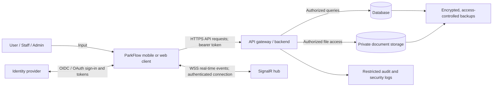
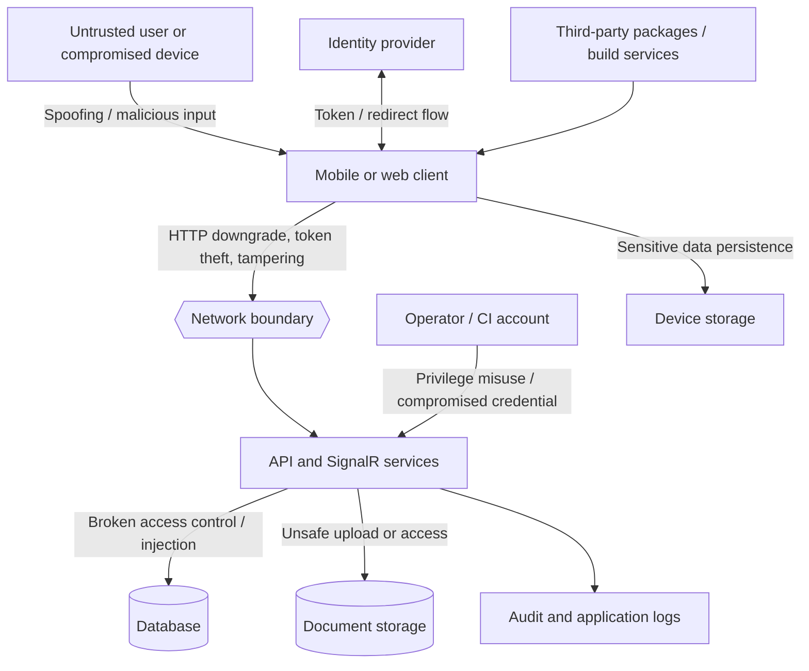
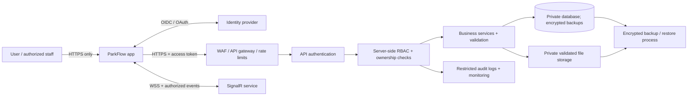
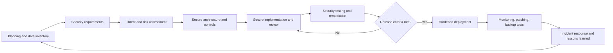

# SECURITY MEASURES DOCUMENTATION FOR PARKFLOW MOBILE APP USING THE SECURE SOFTWARE DEVELOPMENT LIFE CYCLE

> **Document status:** Capstone security plan based on a limited review of the ParkFlow Mobile App repository. Recommendations are proposed controls unless explicitly labeled as observed. The API, database, identity-provider tenant configuration, cloud infrastructure, and production deployment are outside the reviewed repository and have not been independently verified. Do not treat this document as evidence that security tests have passed.

## Cover Page

**Name of School:** [School Name]  
**College / Department:** [College / Department]  
**Course:** [Course Name and Code]  
**Capstone Project:** ParkFlow Mobile App  
**Document Title:** Security Measures Documentation  
**Group Members:** [Names]  
**Instructor:** [Instructor Name]  
**Section:** [Section]  
**Date of Submission:** [Date]

---

## 1. Executive Summary

ParkFlow Mobile App is a mobile client built with Expo, React Native, TypeScript, and JavaScript. Repository features and service modules indicate support for account and profile workflows, vehicle and parking operations, schedules or reservations, documents, QR-related functions, notifications, and real-time updates. The app communicates with an API and a SignalR service; the server-side implementation and production data stores are not present in the reviewed repository. Microsoft identity-provider configuration is present in the client environment template. These findings describe the client project and should be confirmed with the capstone team and system owner before submission.

The system may handle account identifiers, contact/profile information, vehicle details, parking activity, uploaded documents, authentication tokens, and operational events. These data can identify people, reveal behavior, or enable account abuse if disclosed or changed without authorization. The project should collect only information needed to deliver its parking functions and should define a retention period and deletion process for each data category.

The most significant issue identified in the client configuration review is that `services/apiConfig.ts` defines an HTTP IP-address default and accepts either HTTP or HTTPS. This creates a risk that a misconfigured build could send credentials or personal data without transport encryption. A second concern is that the shared storage helper uses native SecureStore on iOS/Android but falls back to browser `localStorage` on web, where same-origin script execution can expose tokens. The repository also contains a development HTTP allowance in `.env.example`; confirm it is disabled for production builds. Server-side authorization, upload validation, rate limiting, encryption at rest, audit logging, backups, and incident controls cannot be confirmed from the mobile client alone.

The recommended priority actions are: require HTTPS/WSS in production and fail closed for insecure endpoints; review web session storage and token lifecycle; enforce authorization and resource ownership on every server route; validate uploaded documents on the server; prevent sensitive data from entering logs; scan and update dependencies; and test the release configuration before deployment. This report follows Secure SDLC stages and provides a threat model, risk register, requirements, access-control proposal, tests, deployment checklist, privacy considerations, incident response plan, and maintenance activities. All proposed controls should be assigned to responsible project members and verified with evidence before being marked complete.

## 2. System Overview

### 2.1 System Description

ParkFlow is a mobile application intended to support parking-related user and operational workflows. Based on repository structure, the client includes authentication, account, vehicle, schedule, history, announcement, notification, QR, and violation-related feature areas. The app uses Axios for API communication and SignalR for real-time communication. The backend, database, cloud storage, and actual business rules are external to this repository; their exact behavior must be confirmed by the project team.

### 2.2 Target Users

| User type | Intended responsibilities | Security boundary |
|---|---|---|
| Registered user / driver | Manage own account and vehicle information; use parking and schedule features | Can access only own private records and permitted public functions |
| Visitor / guest | View public information or use explicitly enabled guest workflows | No access to private account, vehicle, or parking records |
| Parking staff / guard | Carry out assigned parking, QR, verification, or operational tasks | Access limited to assigned site, task, and minimum necessary data |
| Administrator | Manage accounts, permissions, operational settings, and escalations | Privileged access; MFA, least privilege, and audited actions required |
| Support / developer | Diagnose and maintain service | No routine access to production personal data; time-limited, approved access if needed |

These roles are a proposed model, not confirmation of current backend roles. The team must align them with actual workflows.

### 2.3 System Components

| Component | Purpose | Scope / security note |
|---|---|---|
| Expo / React Native mobile client | User interface and client-side workflows | Client is untrusted; do not rely on it to enforce permissions or protect embedded secrets |
| Web build, if deployed | Browser-based client | Review token handling, origin security, and XSS protections separately |
| REST API | Authentication and application data/business operations | Not included in this repository; must enforce server-side validation and authorization |
| SignalR hub | Real-time events and status updates | Authenticate connections, authorize subscriptions, validate messages, and use WSS |
| Identity provider | Sign-in and token issuance (Microsoft identity configuration appears in the client template) | Verify tenant, redirect URI, issuer, audience, scopes, token lifetime, and account lifecycle settings |
| Database / file storage | Persistent account, parking, and document data | External to repository; restrict network and service access; encrypt and back up |
| Build and release pipeline | Produces application builds and updates | Protect signing/release credentials and limit publishing access |
| User device | Stores app data and session material | Device may be lost, rooted, shared, or compromised; minimize local sensitive data |

### 2.4 Data Flow and Trust Boundaries



**Trust boundaries:** user/device to app; app to identity provider; app to API/hub; backend services to data stores; production systems to operators and CI/CD. Treat all client inputs and client-side role indicators as untrusted. Do not put credentials, private signing keys, or privileged API secrets in the mobile bundle. Production network paths must use HTTPS and WSS.

## 3. Security Objectives

- **Confidentiality:** Restrict personal, vehicle, document, account, and activity data to authorized people and services.
- **Integrity:** Prevent unauthorized changes to accounts, permissions, vehicle details, parking records, and audit evidence; validate state transitions on the server.
- **Availability:** Maintain service during expected demand and recover from failures using monitored infrastructure and tested backups.
- **Authentication:** Verify user and service identities using a supported identity protocol and validate tokens server-side.
- **Authorization:** Enforce least privilege, role permissions, and record ownership on every API and real-time operation.
- **Accountability:** Record security-relevant actions with actor, time, target, and outcome while avoiding secrets and unnecessary personal data in logs.
- **Privacy:** Limit collection, use, sharing, and retention; provide a process for access, correction, and deletion requests consistent with applicable requirements.

## 4. Asset Identification

| Asset | Description | Importance | Security requirement |
|---|---|---:|---|
| Identity and account records | User identifiers, authentication status, profile data | High | Minimize, restrict, encrypt where appropriate, and audit access |
| Access and refresh tokens | Credentials representing authenticated sessions | Critical | Short-lived where feasible; secure storage; never log; support revocation |
| Vehicle information | Vehicle identifiers/details associated with an account | High | Ownership checks and limited staff access |
| Parking and schedule records | Reservations, entry/exit, history, violations, or operational status | High | Server-side authorization, integrity protection, retention limits |
| Uploaded documents/images | Registration or other user-submitted files, if collected | High | Validate content and size; private storage; authorized downloads; retention/deletion |
| QR codes / QR payloads | Identifiers or proof used in parking workflows | High | Do not treat a visible QR value alone as authorization; use server validation and expiry/replay controls |
| API and SignalR traffic | Requests, responses, real-time payloads | High | HTTPS/WSS, token validation, schema validation, safe logging |
| Source code and dependencies | Application logic and libraries | High | Least-privilege repository access, review, lockfile, scanning |
| Build and release credentials | Signing, CI, store, or OTA publishing credentials | Critical | Secret manager, restricted scopes, rotation, protected release workflow |
| Logs and monitoring | Security and operational events | Medium–High | Redaction, access restrictions, tamper resistance, defined retention |
| Backups and configuration | Recoverable data and production configuration | High | Encryption, separate access, integrity verification, tested restoration |

## 5. Data Classification

| Classification | ParkFlow examples | Reason and handling |
|---|---|---|
| Public | Public service announcements and general app information | Intended for public viewing; verify content before publication |
| Internal | Non-public operational settings, deployment runbooks, non-sensitive system metadata | Limit to project and operations personnel; do not publish configuration unnecessarily |
| Confidential | Names/contact details, vehicle records, parking schedules/history, staff operational records | Personal or operational impact if disclosed; restrict by role and purpose |
| Highly Confidential / Sensitive | Authentication tokens, credentials, identity/registration documents, security keys, sensitive incident evidence | Highest impact if exposed; use tightly restricted access, protected storage, encryption, redaction, and short retention where possible |

The exact data inventory must be validated against backend schemas and actual app behavior. Values prefixed `EXPO_PUBLIC_` are included in a client build and must be considered public; they are suitable only for non-secret configuration such as a public client ID or API URL, never for private credentials or privileged keys.

## 6. Security Requirements

“High” and “Critical” items are release requirements unless an authorized owner documents a time-bounded exception and compensating controls.

| ID | Type | Requirement | Priority |
|---|---|---|---|
| SEC-001 | Functional | Authenticate users before access to protected features; validate token signature, issuer, audience, expiry, and intended use at the server. | Critical |
| SEC-002 | Functional | Enforce role permissions and record ownership on every protected API and SignalR action; deny by default. | Critical |
| SEC-003 | Non-functional | Production app and services shall use HTTPS/WSS only; production configuration shall reject HTTP and fail closed rather than use an insecure fallback. | Critical |
| SEC-004 | Functional | Provide secure logout and server-side session/token revocation or equivalent invalidation; define expiry and refresh behavior. | High |
| SEC-005 | Functional | Validate all client input and uploaded files on the server, including type, size, content, and authorization. | High |
| SEC-006 | Non-functional | Store no passwords in plaintext; if locally managed, store password verifiers server-side using a current, appropriately configured password-hashing scheme. | Critical |
| SEC-007 | Non-functional | Do not log passwords, tokens, document contents, or unnecessary personal data; redact sensitive values from errors and telemetry. | High |
| SEC-008 | Non-functional | Protect sensitive data and backups at rest with access controls and managed encryption; restrict database and file-store network access. | High |
| SEC-009 | Functional | Generate protected audit events for authentication failures, privilege changes, administrative actions, and material record changes. | High |
| SEC-010 | Non-functional | Keep private credentials and signing keys out of source, client bundles, logs, and issue attachments; use approved secret storage. | Critical |
| SEC-011 | Non-functional | Pin/review dependency changes through the lockfile and routinely scan, prioritize, and remediate known vulnerabilities. | High |
| SEC-012 | Non-functional | Apply rate limits and abuse monitoring to sign-in, recovery, QR validation, uploads, and other sensitive or costly operations. | High |
| SEC-013 | Functional | Provide a documented process to request access, correction, and deletion of personal data, subject to applicable retention and legal requirements. | High |
| SEC-014 | Non-functional | Restrict production access and release permissions to named personnel, require review for security-sensitive changes, and retain attributable change records. | High |

## 7. Threat Modeling

### 7.1 Threat-Model Diagram



### 7.2 STRIDE Threat Table

| STRIDE threat | Affected component | Example impact | Principal mitigations |
|---|---|---|---|
| Spoofing | Sign-in, API, SignalR, QR workflow | Account takeover, forged parking action | Identity-provider validation, secure token lifecycle, MFA for privileged roles, server-validated QR with expiry/replay protection |
| Tampering | API, database, client payload, dependencies | Altered profile, vehicle, schedule, or release | HTTPS/WSS, server-side business rules, ownership checks, controlled database writes, code review and dependency verification |
| Repudiation | Admin and operational actions | Disputes or inability to investigate misuse | Protected audit logs with actor/time/action/outcome, synchronized time, restricted log modification |
| Information disclosure | API, logs, storage, device, file service | Exposure of identity, vehicle, activity, token, or documents | Data minimization, access controls, encryption, redacted logs, private file access, secure session storage |
| Denial of Service | API, uploads, SignalR, identity dependency | Users cannot access parking service | Rate limits, payload limits, availability monitoring, capacity planning, graceful degradation, tested recovery |
| Elevation of privilege | Backend roles, admin accounts, CI/CD | Unauthorized administrative actions | Server-side RBAC, least privilege, MFA, separation of duties, authorization tests, restricted release permissions |
| Supply-chain compromise | npm packages, build/update pipeline | Malicious code in released client | Lockfile, dependency scanning, reviewed updates, protected CI, restricted signing and publishing secrets |

## 8. Risk Assessment

Scale: likelihood and impact each range from 1 (Rare/Negligible) to 5 (Almost Certain/Severe). Score = likelihood × impact. Levels: 1–4 Low, 5–9 Medium, 10–16 High, 17–25 Critical. Scores are initial planning estimates, not measured incident probabilities; review them after backend and deployment evidence is available.

| Risk | Likelihood | Impact | Score | Level | Treatment and rationale |
|---|---:|---:|---:|---|---|
| Insecure HTTP endpoint used by production client | 4 | 5 | 20 | Critical | **Mitigate before release:** require HTTPS/WSS, reject insecure production configuration, remove the HTTP IP fallback, and test the built app's network behavior. |
| Token exposure through web `localStorage` if web client is deployed | 3 | 5 | 15 | High | **Mitigate:** assess server-managed secure cookies or another design; reduce token lifetime, protect against XSS, and avoid web deployment until reviewed. |
| Broken object-level or role authorization in API | 3 | 5 | 15 | High | **Mitigate:** implement server-side ownership/RBAC checks and negative tests for each endpoint; client UI restrictions are insufficient. |
| Sensitive data or bearer tokens written to logs | 3 | 4 | 12 | High | **Mitigate:** remove/redact payload and credential logs; inspect production telemetry and restrict log access. |
| Malicious or unauthorized document upload/download | 3 | 4 | 12 | High | **Mitigate:** enforce server-side content/size checks, private storage, malware screening as appropriate, authorization, and retention. |
| Account takeover through weak session/recovery controls | 3 | 5 | 15 | High | **Mitigate:** use identity-provider protections, rate limits, secure recovery, privileged MFA, revocation, and alerting. |
| API or SignalR outage / abusive traffic | 3 | 4 | 12 | High | **Mitigate:** rate limiting, monitoring, capacity planning, operational runbooks, and backup/recovery. |
| Compromised dependency or release credential | 2 | 5 | 10 | High | **Mitigate:** scan dependencies, restrict CI secrets and publishing permissions, require review, and rotate exposed credentials. |

**Treatment options:** Avoid by removing a risky feature or data collection; mitigate with controls; transfer through suitable service/vendor arrangements while retaining oversight; or accept only with documented owner approval, rationale, expiry, and compensating controls. Critical and High risks should not be silently accepted.

## 9. Secure System Design

The proposed architecture separates client, identity, API, data, and operational trust zones. The backend is the policy enforcement point: it authenticates every request, authorizes the user's role and ownership of the specific record, validates data, and controls access to storage. Apply a WAF/API gateway and rate limits where available, but do not treat them as substitutes for application authorization. Use a private database and private document storage, centralized protected logs, and encrypted backups.



## 10. Authentication and Authorization

### 10.1 Authentication

The repository includes an authentication feature area and Microsoft identity configuration in the example environment file. A client ID and tenant ID are identifiers, not confidential secrets, but they must still be configured for the correct application and tenant. Never include a client secret or private credential in the app. Confirm that the backend validates tokens and that redirect URIs, scopes, issuer, audience, nonce/state, and token lifetimes are correct for each platform.

Recommended controls:

- Use the approved identity provider and standard authorization-code flow with PKCE for native public clients, as appropriate to the provider and platform.
- Require MFA for administrators and staff with sensitive privileges where supported.
- Apply rate limiting and monitoring to authentication and recovery; avoid revealing whether an account exists in public error messages.
- Define token expiry, refresh, revocation, sign-out, and lost-device procedures. Do not persist tokens longer than needed.
- Store native session material in platform-protected storage. Treat browser `localStorage` as exposed to any successful same-origin script execution; review a secure web session architecture before enabling web deployment.
- Avoid sensitive information in deep links and notification previews. Validate callback state and destination URLs.

### 10.2 Proposed Access Control Matrix

| Function / data | Visitor | Registered user | Staff / guard | Administrator |
|---|---:|---:|---:|---:|
| View public announcements | Yes | Yes | Yes | Yes |
| View/edit own profile | No | Own data | Own data | Only when needed and audited |
| View/manage own vehicles and parking records | No | Own data | Only for assigned operational task | Only for approved support need |
| Submit or manage own parking request | No / explicitly limited | Own requests | Operational actions only | As required by role |
| Verify parking QR / entry event | No | No | Assigned site/task only | Only if explicitly assigned |
| View another user's private records | No | No | Minimum assigned task only | Restricted, purpose-based, audited |
| Approve users/documents or change roles | No | No | Only if expressly delegated | Authorized administrators only |
| Change system configuration / manage privileged users | No | No | No | Yes, MFA and audit required |

The server must enforce every permission on each request and real-time subscription. Hiding navigation elements in the app is not access control. Use deny-by-default behavior and test both allowed and denied cases.

## 11. Data Security

### Data at Rest

- Use database and storage encryption supported by the production platform; manage encryption keys separately from the data and restrict key access.
- Restrict database connectivity to required services and authorized administrators. Use separate credentials per environment and rotate them through a controlled process.
- Store native tokens using OS-backed secure storage. Do not cache confidential documents or full personal records on-device unless necessary; use platform-protected storage and define cache clearing on logout.
- Store uploaded files outside public web paths and issue access only after server-side authorization. Use randomized storage names and avoid sensitive data in filenames.
- Encrypt backups, restrict restore permissions, and regularly verify backup integrity and restore procedures.

### Data in Transit

- Enforce HTTPS for REST calls, WSS for SignalR, and secure transport for identity and file services. Production must not accept fallback HTTP endpoints or cleartext traffic.
- Validate TLS certificates through the platform defaults; never disable certificate validation to bypass errors.
- Ensure redirects do not downgrade secure traffic, and use secure endpoint configuration for every environment.
- Review mobile platform settings so development exceptions do not leak into release builds.

### Passwords and Sensitive Data

If ParkFlow delegates passwords to an identity provider, password storage and verification are the provider's responsibility; the project must not collect or store the provider's password. If the backend has local passwords, store only salted password hashes using a modern password-hashing scheme (for example, Argon2id or an appropriately configured bcrypt/PBKDF2 implementation), with parameters reviewed against current guidance. Never store plaintext or reversible passwords. Protect identity documents, tokens, contact information, vehicle details, and parking history with least privilege, retention limits, and access logging.

## 12. Secure Coding Practices

| Area | ParkFlow implementation practice |
|---|---|
| Input validation | Validate type, size, format, and allowed values at the API boundary; client validation improves usability but is not trusted. |
| Authorization | On every backend route, verify identity, role, record ownership, and current workflow state; enforce for SignalR groups and events too. |
| Injection | Use parameterized queries or safe ORM APIs in the backend; never build database commands from user-controlled strings. |
| XSS / rendering | Render untrusted content as text, sanitize only when rich text is required, and apply appropriate web security headers if web is deployed. |
| File handling | Enforce allowed types, size limits, content checks, safe filenames, authorization, private storage, and safe download headers. |
| QR workflows | Treat scanned codes as untrusted input; validate server-side, bind to intended action/user/context, expire them, and prevent replay. |
| Session handling | Use protected storage, expiry/revocation, secure logout, and safe deep-link/callback handling. |
| Errors | Return generic user-facing errors; keep stack traces, internal URLs, tokens, and sensitive payloads out of client messages. |
| Logs | Log event metadata needed for investigation; redact tokens, document contents, passwords, and unnecessary personal identifiers. |
| Secrets | Keep credentials in protected CI/deployment secret storage; client-visible environment values are public. |
| Dependencies | Maintain `package-lock.json`, review changes, run vulnerability scanning, and remove unused packages. |
| Real-time communication | Authenticate SignalR connections, authorize subscriptions, validate payloads, and handle reconnect/token expiry safely. |

## 13. Secure Development / Implementation

### Source Code Management

- Limit repository write and administration access to active team members; remove access promptly when roles change.
- Protect the default branch with pull requests, required review, and required CI checks. Require additional review for authentication, storage, API configuration, release workflows, and permissions.
- Keep commits attributable and focused; do not commit `.env` files, credentials, personal data, or production exports.
- Require review of security impact and test evidence for changes to data flows, permissions, dependencies, and deployment settings.
- Maintain a process for reporting security issues privately rather than publishing exploit details or credentials.

### Secrets Management

Keep API private keys, backend credentials, signing keys, store credentials, and CI/OTA tokens in a dedicated secret manager or protected GitHub Actions environment secrets with least privilege. Use separate development, test, and production values. Do not place secrets in `EXPO_PUBLIC_*` variables, source code, app bundles, screenshots, logs, or this document. Rotate credentials if exposure is suspected, and audit the repository and build artifacts for accidental disclosure.

### Dependency Management

The repository contains `package.json` and `package-lock.json` and uses Expo/React Native, Axios, SignalR, SecureStore, and related packages. Pin and review dependency updates through the lockfile, monitor advisories, scan direct and transitive dependencies in CI, and prioritize fixes based on exploitability and exposure. Test updates before release and record exceptions with an owner and deadline. Avoid unreviewed packages and remove unused dependencies.

## 14. Security Testing

Testing must be performed only against project environments, systems, and accounts for which the team has explicit authorization. Use synthetic data where possible. Record test date, build/version, environment, test case, result, evidence reference, and remediation; redact tokens and personal data from evidence.

| Test area | Proposed tests / expected result |
|---|---|
| Authentication | Missing, invalid, expired, wrong-audience, and revoked tokens are rejected; sign-out invalidates the session as designed; recovery and callback flows resist replay and abuse. |
| Authorization | A user cannot read/change another user's profile, vehicle, document, reservation, history, or QR event; staff and admin actions are limited to role and assignment. |
| Transport | Production release has no HTTP endpoint, cleartext allowance, or HTTPS-to-HTTP downgrade; API and SignalR use HTTPS/WSS with valid certificates. |
| Input validation | Malformed, oversized, unexpected, and injection-like values are rejected safely; no internal stack trace or data leak is returned. |
| File upload/download | Unapproved types, oversized files, suspicious names, unauthenticated uploads, and unauthorized retrieval are rejected; files are not publicly enumerable. |
| API / abuse controls | Sensitive routes enforce rate limits and request size limits; error responses do not disclose account existence or internal details. |
| SignalR | Unauthenticated connection, unauthorized subscription, invalid event, expired token, reconnect, and replay cases are tested. |
| Storage / privacy | Native token storage and logout clearing are verified; web storage decision is reviewed; logs and analytics contain no secrets or unnecessary personal data. |
| Dependency / source | Run dependency audit and static checks; investigate findings and document accepted false positives. |
| Recovery | Restore a backup in a non-production environment and verify integrity and service recovery steps. |

Recommended tools include OWASP ZAP for authorized test environments, static analysis and linting, npm audit or an approved dependency scanner, and platform-specific mobile configuration checks. Tool output is evidence to triage, not proof of security by itself.

## 15. Vulnerability Assessment

This is a repository-level preliminary review, not a penetration test or a complete vulnerability scan. The table distinguishes observed configuration from controls that cannot be assessed in this client repository. No finding is marked “Fixed” without verification evidence.

| Finding | Location / evidence | Severity | Recommended fix | Status |
|---|---|---|---|---|
| API configuration includes an HTTP IP default and accepts `http:` | `services/apiConfig.ts` defines `DEFAULT_API_URL` with HTTP and accepts both HTTP and HTTPS | High / release-blocking | Remove insecure production default; require HTTPS in release configuration and fail build/startup for HTTP outside local development; verify all API and SignalR URLs | Open / verify |
| Web token fallback uses browser `localStorage` | `services/storage.ts` uses `window.localStorage` on web | Medium–High if web deployed | Decide whether web is supported; if so, design a safer session architecture and mitigate XSS; shorten token lifetime and document residual risk | Open / design review |
| Development HTTP allowance appears in environment template | `.env.example` contains `EXPO_PUBLIC_ALLOW_LOCAL_HTTP=true` | Medium, configuration-dependent | Confirm it is only for local development; ensure production builds override or reject it and test compiled configuration | Open / verify |
| Backend authorization, upload validation, and database protections not verifiable | Backend and production infrastructure are outside this repository review | High, unverified | Review backend source/configuration and test route-level ownership, roles, uploads, data access, logging, and backups | Not assessed |
| Sensitive logging behavior requires review | Client and real-time services should be checked for token or payload logging during implementation | Medium, unverified | Inspect release logging paths; redact or remove sensitive values and verify with tests | Not assessed |

**Evidence limitation:** line-level/source review indicates configuration risks but does not demonstrate exploitability in a deployed system. Attach redacted scan/test outputs and remediation commits after authorized verification.

## 16. Secure Deployment

Use distinct development, test, and production configurations. Release builds should use approved HTTPS/WSS endpoints, production identity-provider settings, protected secrets, restricted backend data stores, and limited publishing permissions. Disable debug behavior and remove sample/test accounts before production. Verify release artifacts rather than relying only on source configuration.

### Deployment Checklist

- [ ] Production REST and SignalR endpoints use HTTPS/WSS only.
- [ ] Insecure HTTP defaults and cleartext allowances are removed or confined to local development.
- [ ] Production identity-provider tenant, audience, redirect URIs, and scopes have been reviewed.
- [ ] No private credentials or signing keys are embedded in the app bundle or source.
- [ ] Debug mode and sensitive payload logging are disabled in release builds.
- [ ] Backend authorization, upload validation, rate limits, and input validation have passed tests.
- [ ] Database and document storage are private and access-restricted.
- [ ] Default, sample, and former staff accounts have been removed or disabled.
- [ ] CI, signing, store, and OTA publishing permissions are limited and audited.
- [ ] Backups are encrypted, access-controlled, and restoration-tested.
- [ ] Monitoring, escalation contacts, and incident runbooks are ready.
- [ ] High/Critical findings are resolved or have approved, time-limited exceptions.
- [ ] Privacy notice, retention schedule, and data-subject request process are available.

## 17. Security Monitoring and Logging

Log successful and failed authentication events, account recovery, privilege changes, administrative actions, sensitive record changes, upload/download authorization outcomes, API abuse/rate-limit events, security exceptions, and service health events. Record timestamp, actor or pseudonymous identifier, action, target type/identifier where necessary, outcome, and correlation ID.

Do **not** log passwords, bearer/refresh tokens, private keys, full document content, or unnecessary personal data. Restrict log access to authorized operations/security personnel; protect logs against unauthorized modification and deletion; synchronize system clocks; and define retention based on operational need and applicable privacy rules. Alert on repeated authentication failures, unusual privilege changes, unexpected production HTTP use, suspicious download patterns, and service disruption. Define retention periods with the project owner/DPO rather than retaining logs indefinitely.

## 18. Incident Response Plan

**Response roles:** designate a project incident lead, technical/backend contact, identity/cloud provider contact, and privacy/DPO or school privacy contact. Maintain out-of-band escalation details in the operational runbook, not in public client documentation. Preserve evidence and keep an incident timeline.

1. **Preparation:** Maintain contacts, access revocation procedures, tested backups, asset/data inventory, and communication templates. Practice the plan.
2. **Detection and analysis:** Record what happened, when, affected services/accounts, indicators, data types and people potentially affected, and confidence level. Preserve relevant logs securely.
3. **Containment:** Disable compromised accounts or tokens, restrict affected endpoints, isolate affected systems, block malicious traffic, and pause unsafe releases or uploads as appropriate.
4. **Eradication:** Remove malicious code or configuration, patch the root cause, rotate potentially exposed credentials, and verify clean build/deployment artifacts.
5. **Recovery:** Restore verified systems/data where needed, validate access controls and integrity, monitor closely, and communicate service status through approved channels.
6. **Lessons learned:** Document cause, impact, decisions, notifications, evidence, and corrective actions; assign owners and due dates; update threat model and tests.

For suspected personal-data breaches, promptly involve the responsible organization and its Data Protection Officer. Assess notification and reporting duties under the Data Privacy Act, its implementing rules, and current National Privacy Commission guidance; the organization/DPO and counsel should determine applicability, affected parties, and deadlines. Do not make unsupported promises or disclose sensitive evidence through public channels.

## 19. Backup and Recovery

The backend owner should define recovery objectives based on business impact. Initial planning targets (to be agreed and validated, not current measured service commitments) are **RPO: 24 hours** and **RTO: 8 hours** for core parking records. Adjust these targets to operational needs and provider capabilities.

```text
Production database and private files
        -> scheduled encrypted backup
        -> isolated, access-controlled backup storage
        -> integrity / completion verification and retention rotation
        -> authorized restore into isolated recovery environment
        -> data integrity and application checks
        -> approved return to service
```

Back up required databases, private files, and recovery-critical configuration; do not back up secrets in plaintext. Separate backup administration from routine app access, protect backups from deletion or ransomware, define retention and secure deletion, and test restoration at least periodically and after material architecture changes. Record the test result and measured recovery time.

## 20. Privacy and Data Protection

The app may process identifiers, contact/profile data, vehicle information, parking activity, uploaded documents, and authentication metadata. Confirm the actual collection and purpose through the app and backend data inventory; do not assume every possible data type is collected. For each field, document purpose, legal basis/authority as determined by the responsible organization, recipients, storage location, retention, access roles, and deletion method.

For a Philippine-based project, consider Republic Act No. 10173 (Data Privacy Act of 2012), its Implementing Rules and Regulations, and current National Privacy Commission guidance. The school or system owner should identify the personal information controller/processor roles and consult its DPO. Publish an understandable privacy notice; collect only data necessary for defined purposes; protect records; allow correction and applicable access/deletion requests; manage third-party processors; and assess breach response obligations. This student document is not legal advice. Never put real personal information in screenshots, sample data, issues, or test evidence.

## 21. Secure SDLC Implementation Matrix

| SDLC stage | ParkFlow security activity | Deliverable / evidence |
|---|---|---|
| Planning | Identify users, data, security objectives, owners, and legal/privacy considerations | Approved scope, data inventory, security objectives |
| Requirements | Convert threats and privacy needs into testable security requirements | SEC-001 onward requirements and acceptance criteria |
| Risk analysis | Review trust boundaries and STRIDE threats; estimate and assign risk owners | Threat model and maintained risk register |
| Design | Design HTTPS/WSS paths, server-side RBAC, storage boundaries, logging, and recovery | Secure architecture, data-flow diagram, access matrix |
| Development | Secure coding, PR review, secret handling, dependency hygiene, and abuse-case review | Reviewed changes, CI results, dependency findings/remediation |
| Testing | Test authentication, authorization, inputs, files, real-time service, release config, and recovery | Security test report with version, evidence, and defects |
| Deployment | Harden production configuration, protect secrets, restrict access, and verify release artifact | Completed release checklist and approval |
| Operations / maintenance | Monitor, patch, review access, test backups, and reassess risks | Maintenance log, vulnerability status, restore-test evidence |
| Incident response | Detect, contain, recover, notify as required, and learn | Incident record, corrective actions, updated controls |

## 22. Security Control Matrix

| Control | Primary implementation point | Owner (assign) | Verification |
|---|---|---|---|
| HTTPS/WSS enforcement | Client build configuration, API, SignalR, hosting | Mobile + backend lead | Release-config test; verify network traffic |
| Authentication/token validation | Identity provider and backend middleware | Identity/backend lead | Invalid/expired/wrong-audience token tests |
| RBAC and ownership checks | Every backend route and hub operation | Backend lead | Positive/negative authorization test matrix |
| Secure token storage | Native client; web architecture if applicable | Mobile lead | Platform storage and logout tests |
| Input and upload validation | API and private file service | Backend lead | Invalid payload and file test suite |
| Data/log protection | Database, storage, telemetry | Operations/privacy lead | Configuration review and redaction test |
| Secret and release protection | CI/CD, secret manager, app signing | Release maintainer | Permission review and artifact secret scan |
| Backup and recovery | Database, object store, backup platform | Operations lead | Restore exercise with measured RPO/RTO |
| Privacy lifecycle | Product/data owner and DPO | Project owner | Data inventory, notice, retention/deletion review |

## 23. Security Policies and Procedures

The project should maintain the following lightweight operational policies and review them at least annually and after major changes:

- **Access control:** named accounts, least privilege, MFA for privileged roles, access review, prompt offboarding, and auditable emergency access.
- **Secure development:** peer review, protected branches, required checks, secure coding, authorized testing only, and private vulnerability reporting.
- **Secrets and configuration:** no secrets in source/client bundles; separate environments; controlled rotation; production release approval.
- **Data handling and privacy:** classification, purpose limitation, approved sharing, retention/deletion, and redacted test evidence.
- **Vulnerability and patch management:** scheduled dependency review, severity-based remediation deadlines, and documented exceptions.
- **Logging and incident response:** event coverage, access/retention limits, escalation, evidence preservation, and post-incident improvements.
- **Backup and continuity:** protected backups, assigned recovery owners, documented targets, and periodic restoration exercises.

## 24. Security Checklist

### Authentication and Authorization
- [ ] Authentication is required for protected resources.
- [ ] Tokens are validated by the backend and have defined expiry/revocation behavior.
- [ ] Privileged accounts use MFA where supported.
- [ ] Roles and resource ownership are enforced server-side.
- [ ] Session logout and account recovery have been tested.

### Application and Data
- [ ] HTTPS/WSS is enforced in production; HTTP is rejected.
- [ ] Input and file validation occurs server-side.
- [ ] Sensitive errors and logs are redacted.
- [ ] Database and document access is restricted.
- [ ] Retention, correction, and deletion procedures are defined.
- [ ] Client bundles contain no private credentials.

### Development and Operations
- [ ] Branch protection and review are enabled.
- [ ] Dependencies are scanned and known findings triaged.
- [ ] Release and CI secrets have least privilege.
- [ ] Monitoring and incident escalation are in place.
- [ ] Backups are protected and restoration is tested.
- [ ] High/Critical findings are fixed or approved as time-limited exceptions.

## 25. Evidence and Supporting Documentation

Attach or link to project-controlled, redacted evidence before final submission:

| Evidence item | Suggested artifact | Current status |
|---|---|---|
| System/data-flow and architecture diagrams | Reviewed diagrams in this document or appendix | Proposed; verify with backend/system owner |
| Access-control matrix | Approved role/permission mapping and API coverage | Proposed |
| Security requirements and risk register | This document with assigned owners and review date | Draft |
| HTTPS and release configuration | Redacted build configuration and network test output | Not verified |
| Authentication/authorization tests | Test report and synthetic-account results | Not provided |
| Dependency assessment | Dated scanner output and remediation records | Not provided |
| Vulnerability assessment | Authorized scan report, scope, tool/version, and findings | Not provided |
| Backup/recovery evidence | Redacted restore exercise results and measured recovery time | Not provided |
| Privacy evidence | Approved notice, retention schedule, and request procedure | Not provided |
| Incident response evidence | Contact/runbook review or tabletop exercise record | Not provided |

Screenshots and reports must not disclose passwords, API keys, tokens, private keys, personal information, or confidential credentials. Record evidence dates and app version; redact identifiers and endpoints when they are sensitive.

## 26. Conclusion

ParkFlow's most important identified and proposed risks are insecure production transport configuration, possible exposure of web tokens, broken server-side authorization, unsafe document handling, and leakage through logs or release credentials. The repository review directly observed an HTTP default that should be treated as release-blocking until removed or constrained to local development; it also observed a web `localStorage` fallback. Other backend and operational controls remain unverified because those components were outside the reviewed repository.

A Secure SDLC helps the team make these risks explicit before release, assign controls to the correct client/backend/operations owners, and require evidence through design review, implementation, testing, deployment, and maintenance. The remaining limitations include the absence of reviewed backend and infrastructure code, unknown real data-retention practices, and lack of test or scan evidence in this document. The next steps are to confirm the system's actual data flows and roles, fix and test production transport settings, review token and web-session design, verify server-side authorization and uploads, perform authorized security testing, and complete privacy and recovery procedures. No system can be described as “100% secure”; residual risk must be monitored and managed.

## 27. References

APA 7-style references; consult the current official publications and guidance when implementing controls.

- European Union Agency for Cybersecurity. (n.d.). *Secure software development lifecycle*. https://www.enisa.europa.eu/topics/cybersecurity-policy/secure-software-development
- Microsoft. (n.d.). *Microsoft identity platform documentation*. https://learn.microsoft.com/en-us/entra/identity-platform/
- National Institute of Standards and Technology. (2022). *Secure software development framework (SSDF) version 1.1: Recommendations for mitigating the risk of software vulnerabilities* (NIST SP 800-218). https://doi.org/10.6028/NIST.SP.800-218
- National Privacy Commission. (n.d.). *Data Privacy Act of 2012*. https://privacy.gov.ph/data-privacy-act/
- OWASP Foundation. (2021). *OWASP Top 10: The ten most critical web application security risks*. https://owasp.org/Top10/
- OWASP Foundation. (2023). *OWASP API Security Top 10—2023*. https://owasp.org/API-Security/editions/2023/en/0x00-header/
- OWASP Foundation. (n.d.). *Application Security Verification Standard*. https://owasp.org/www-project-application-security-verification-standard/
- Republic of the Philippines. (2012). *Republic Act No. 10173: Data Privacy Act of 2012*. Official Gazette. https://www.officialgazette.gov.ph/2012/08/15/republic-act-no-10173/
- Expo. (n.d.). *SecureStore*. https://docs.expo.dev/versions/latest/sdk/securestore/
- GitHub. (n.d.). *About dependency review*. https://docs.github.com/en/code-security/supply-chain-security/understanding-your-software-supply-chain/about-dependency-review

## Appendix A. Secure SDLC Flow



## Appendix B. Document Review Record

| Version | Date | Author / reviewer | Change |
|---|---|---|---|
| 1.0 | [Date] | [Names] | Initial capstone Secure SDLC documentation; validate proposed controls and placeholders before submission. |
